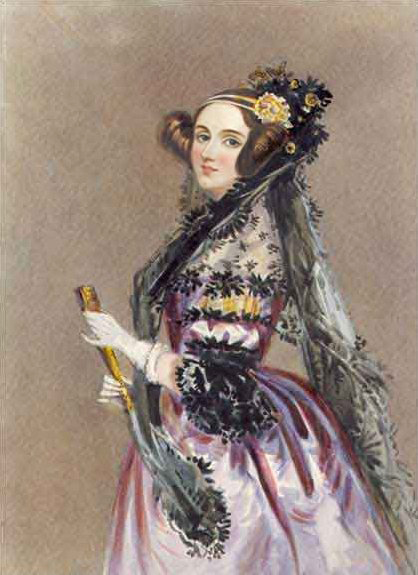

# O Enigma Lovelace

  

## Um segredo de Ada. Sua próxima descoberta.

Uma mensagem foi escondida nos pixels de uma imagem. Para descobrir o que ela diz, você precisa reunir quatro pistas: cada uma revela uma parte do caminho até o último arquivo de Ada.

Inspirado em Ada Lovelace, o desafio convida você a experimentar, observar e conectar ideias. Não precisa saber programar: curiosidade é o ponto de partida.

**[Começar o desafio →](https://enigma-lovace-bay.vercel.app/)**

## Sua missão

Crie sua conta, entre no jogo e explore os quatro núcleos em sequência:

| Núcleo | O que você vai fazer | Pontos |
| --- | --- | --- |
| **Tear** | Reconstruir uma sequência de comandos. | 100 |
| **Pulso** | Acender luzes para recuperar um sinal. | 100 |
| **Prisma** | Organizar canais de cor seguindo as pistas. | 100 |
| **Eco** | Encontrar uma mudança quase invisível. | 100 |

Cada descoberta recupera um fragmento e libera o próximo núcleo. Ao completar os quatro, você reúne **400 pontos** e as pistas para investigar a mensagem final.

## Jogue no seu ritmo

- A jornada é individual e não tem limite de tempo.
- Cada desafio oferece dicas para ajudar você a avançar.
- Você pode tentar novamente: erros e dicas não descontam pontos.
- Seu progresso fica salvo neste navegador, separado por conta.

## O último arquivo

Depois de recuperar os quatro fragmentos, siga para [o último arquivo de Ada](FINAL.md). Use as pistas que reuniu para investigar a imagem e descobrir a mensagem escondida.

A descoberta se completa quando você consegue explicar como chegou até ela.
